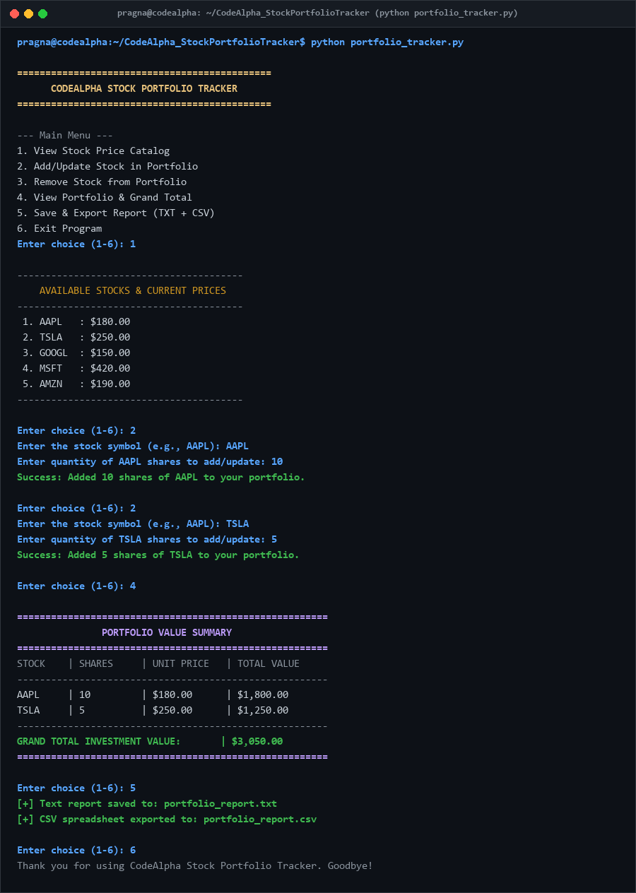

# CodeAlpha Python Programming Internship - Task 2: Stock Portfolio Tracker

<div align="center">


</div>

## 📝 Project Overview
This repository contains an interactive **Stock Portfolio Tracker** CLI application developed in Python for the **CodeAlpha Python Programming Internship (Task 2)**. It allows users to manage and evaluate stock holdings using hardcoded market prices (e.g., Apple, Tesla, Google, Microsoft, Amazon), calculate overall portfolio valuations, and export structured report cards in both **TXT** and **CSV** formats.

---

## 🎯 Task Objectives & Compliance
- [x] **User Inputs**: Prompts users for stock tickers and quantity of shares.
- [x] **Hardcoded Stock Dictionary**: Uses predefined market prices (`{"AAPL": 180.0, "TSLA": 250.0, "GOOGL": 150.0, "MSFT": 420.0, "AMZN": 190.0}`).
- [x] **Total Investment Valuation**: Computes individual holding totals and grand overall investment valuation.
- [x] **File Handling (Optional Requirement)**: Exports formatted `.txt` reports and `.csv` spreadsheet files.
- [x] **Key Concepts Implemented**: Dictionaries, user input/output validation, arithmetic computations, file handling (`open`, `csv.writer`).

---

## 📸 Execution Preview
Below is the verified running screenshot of the Stock Portfolio Tracker in terminal:

<div align="center">



</div>

---

## ✨ Features
- **Price Catalog**: Displays all available stock symbols and real-time fixed price listings.
- **Stock Addition & Updates**: Adds new tickers or seamlessly increments quantities for existing holdings.
- **Stock Removal**: Reduces share counts or completely removes tickers with ownership validation checks.
- **Formatted Portfolio Table**: Renders an ASCII tabular overview detailing ticker symbol, shares held, unit price, and total valuation.
- **Dual-Format Export Engine**:
  - `portfolio_report.txt`: Clean, human-readable summary document.
  - `portfolio_report.csv`: Industry-standard CSV format compatible with Excel and Google Sheets.
- **Resilient Input Sanitization**: Rejects invalid tickers, non-numeric quantities, negative integers, and handles interrupts gracefully.

---

## 🛠️ Technologies Used
- **Language**: Python 3.x
- **Standard Libraries**: `csv`, `os`, `sys`
- **Dependencies**: None (100% built-in standard library)

---

## 📂 Repository Structure
```text
CodeAlpha_StockPortfolioTracker/
│
├── portfolio_tracker.py       # Main Application Script
├── README.md                  # Project Documentation & Guide
├── .gitignore                 # Git Ignore File
└── screenshots/
    └── run_preview.png        # Terminal Running Screenshot
```

---

## 🚀 How to Run Locally

### Prerequisites
- Python 3.8 or higher installed.
  ```bash
  python --version
  ```

### Step-by-Step Execution
1. **Clone the repository:**
   ```bash
   git clone https://github.com/pragna3101/CodeAlpha_StockPortfolioTracker.git
   ```
2. **Navigate into the directory:**
   ```bash
   cd CodeAlpha_StockPortfolioTracker
   ```
3. **Run the tracker:**
   ```bash
   python portfolio_tracker.py
   ```
4. **Menu Options:**
   - `1`: View stock catalog.
   - `2`: Add shares (e.g. `AAPL`, quantity `10`).
   - `3`: Remove / reduce shares.
   - `4`: View dynamic valuation table and grand total.
   - `5`: Export reports to `portfolio_report.txt` and `portfolio_report.csv`.
   - `6`: Exit application.

---

## 👤 Author
- **Pragna Zala**
- **GitHub**: [@pragna3101](https://github.com/pragna3101)
- **Internship**: CodeAlpha Python Programming Intern
